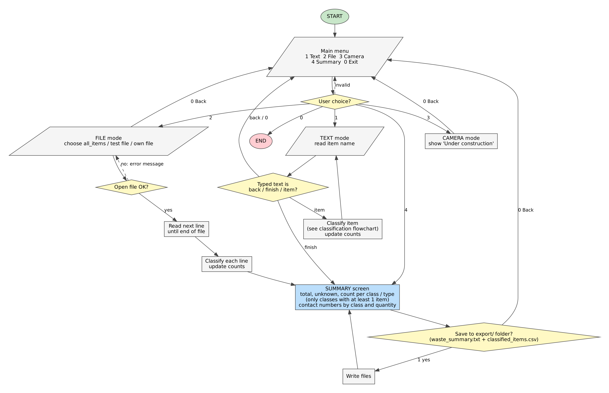
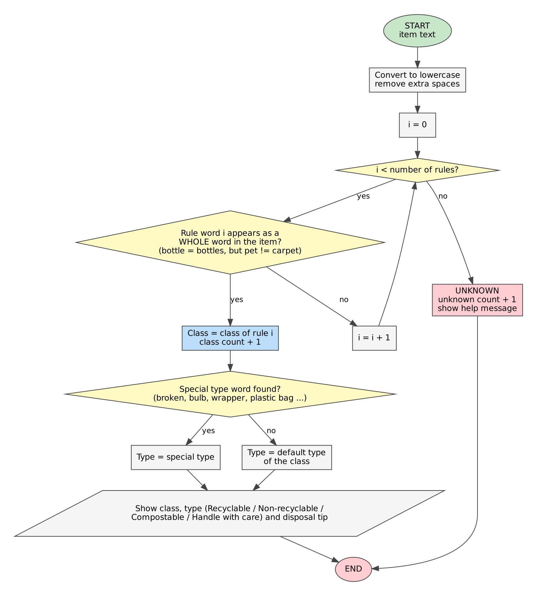

# Intelligent Waste Classification Simulator (C)

A C mini-project that classifies a waste item (typed by the user or read from a file) into a
predefined class and shows how to dispose of it.

> **Important:** this is a **rule-based, educational** program. It matches keywords against a
> predefined table. It does **not** use a camera, sensors or AI. Real disposal rules vary by
> location, so always follow your local waste management rules.

## Features

- Three modes from a simple number menu (`1`, `2`, `3` ... no mouse or arrow keys)
  1. **Text based**: type an item such as `plastic bottle`, `bread` or `old phone`. Type `finish` for the summary.
  2. **File based**: read items from `data/all_items.txt`, a test file, or any file you name.
  3. **Camera / Image based**: shows "under construction".
- `0` = **Back** on every screen.
- **Classes:** Paper, Plastic, Glass, Metal, Organic, E-waste.
- **Types:** Recyclable, Non-recyclable, Compostable, Handle with care.
- **Summary screen:** total and unknown counts, counts per class and type (only classes with at least one item), and a Bengaluru waste management contact based on the class and the quantity (small / bulk).
- **Export:** save the summary (`.txt`) and the item list (`.csv`) into the `export/` folder.
- Case-insensitive input, whole-word matching (`carpet` is not mistaken for `pet`), and a helpful message for unknown items or invalid menu choices.

## Project structure

```
waste-classifier/
├── src/waste_classifier.c     source code
├── data/all_items.txt         about 100 items covering every class (toys, bread, vegetables ...)
├── tests/                     test files, 10 items each, plus run_tests.sh
├── export/                    summary files are saved here
├── docs/                      algorithm, flowcharts, sample output
├── Makefile
└── README.md
```

## Build and run

Run everything from the project folder (the one that contains `data/`, `tests/` and `export/`).

```bash
gcc src/waste_classifier.c -o waste_classifier
./waste_classifier          # on Windows: waste_classifier.exe
```

or with make: `make run`

### Quick demo

1. Press `2` (File based), then `1` (All items file).
2. Press `1` to see the summary, then `1` again to save it to `export/`.

## Test files

| File | Items | Expected result |
|---|---|---|
| `tests/test_paper.txt` | 10 | 10 Paper |
| `tests/test_plastic.txt` | 10 | 10 Plastic (3 non-recyclable) |
| `tests/test_glass.txt` | 10 | 10 Glass (3 handle with care) |
| `tests/test_metal.txt` | 10 | 10 Metal |
| `tests/test_organic.txt` | 10 | 10 Organic (compostable) |
| `tests/test_ewaste.txt` | 10 | 10 E-waste (handle with care) |
| `tests/test_edge_cases.txt` | 10 + 1 blank line | 5 classified, 5 unknown (uppercase, extra spaces, `carpet`, `candle`, `scanner` ...) |
| `data/all_items.txt` | 101 | 98 classified, 3 unknown |

Run all checks automatically:

```bash
bash tests/run_tests.sh      # or: make test
```

## Documentation

- [Algorithm](docs/ALGORITHM.md)
- Flowchart of the whole program: `docs/flowchart_main.png`
- Flowchart of the classification step: `docs/flowchart_classify.png`
- [Sample output](docs/sample_output.txt)

### Flowchart: main program



### Flowchart: classifying one item



## Sample output (shortened)

```
Total items classified : 98
Unknown items          : 3

Count per class:
  Paper      : 16
  Plastic    : 18
  Glass      : 14
  Metal      : 16
  Organic    : 18
  E-waste    : 16

Count per type:
  RECYCLABLE        : 57
  NON-RECYCLABLE    : 4
  COMPOSTABLE       : 18
  HANDLE WITH CARE  : 19
```


## Adding your own items

Open `src/waste_classifier.c` and add a row to the `rules[]` table, for example
`{"pencil", PAPER}`. Special handling words go in the `typeRules[]` table.
Remember that the **first matching rule wins**, so material words (plastic, glass, steel ...) come first.

## Contact numbers

The waste management phone numbers in the `cat[]` table are **placeholders** (`XXXXXXXXXX`), except
the BBMP Sahaya helpline `1533`. Replace them with numbers you have verified before using the program.

## C concepts used

Functions, `switch`, `if`/`else`, loops, arrays, strings (`strcmp`, `strcpy`, `strcat`, `strstr`, `strncpy`),
`struct`, constants (`#define`, `const`), pointers, text file handling (`fopen`, `fgets`, `fprintf`, `fclose`)
and input validation.
